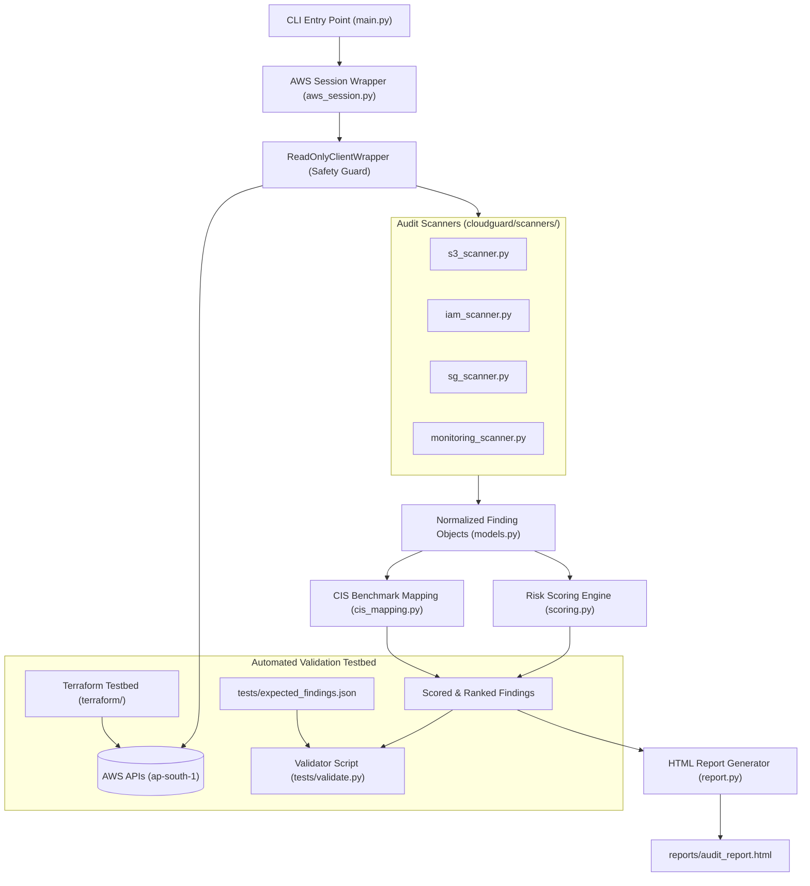

# CloudGuard Architecture Document

CloudGuard is a lightweight, read-only Cloud Security Posture Management (CSPM) tool built with Python (`boto3`) and Jinja2. It audits an AWS account for security misconfigurations across storage, identity, networking, and logging, applies a transparent mathematical risk score to each finding, maps issues to the CIS AWS Foundations Benchmark, and outputs an actionable, executive HTML report.

---

## 1. High-Level Architecture Diagram



---

## 2. Module Directory & Responsibilities

| File Path | Role & Viva Explanation |
| :--- | :--- |
| `cloudguard/aws_session.py` | **Authentication & Safety Enforcement**: Configures the `boto3.Session` with profile `cloudguard` and region `ap-south-1`. Wraps every client in `ReadOnlyClientWrapper` which intercepts all method calls and blocks mutations before network packets leave the machine. |
| `cloudguard/models.py` | **Data Contract**: Defines the standard `Finding` dataclass. Ensures all 4 scanners emit uniform objects with id, check name, resource identifier, region, severity, exposure, sensitivity, raw evidence, and remediation. |
| `cloudguard/scanners/s3_scanner.py` | **Storage Audit**: Checks S3 bucket policies, ACLs, S3 Block Public Access settings, and default server-side encryption (SSE-S3/KMS). |
| `cloudguard/scanners/iam_scanner.py` | **Identity Audit**: Audits wildcard permissions (`*:*`), root account usage, IAM users without MFA, old/inactive access keys (>90 days), and overprivileged IAM roles. |
| `cloudguard/scanners/sg_scanner.py` | **Network Perimeter Audit**: Analyzes EC2 Security Group ingress rules to detect `0.0.0.0/0` exposure on sensitive ports (SSH 22, RDP 3389, MySQL 3306, PostgreSQL 5432, MSSQL 1433, MongoDB 27017). |
| `cloudguard/scanners/monitoring_scanner.py` | **Observability Audit**: Checks whether CloudTrail is enabled across all regions with log file validation, and checks for critical CloudWatch metric alarms. |
| `cloudguard/scoring.py` | **Prioritization Engine**: Calculates numeric risk scores using the formula: `Risk Score = Severity × Exposure × Resource Sensitivity`. Sorts findings in descending order. |
| `cloudguard/cis_mapping.py` | **Compliance Tagging**: Maps each implemented check to official CIS AWS Foundations Benchmark control IDs (e.g., CIS-1.16, CIS-2.1.1, CIS-5.2). |
| `cloudguard/report.py` | **Report Presentation**: Renders an interactive, standalone HTML audit report using Jinja2 templates, detailing executive statistics, risk breakdown, raw evidence, and AWS CLI/Terraform remediation steps. |
| `cloudguard/main.py` | **CLI Orchestrator**: CLI entry point accepting arguments (`--profile`, `--region`, `--smoke-test`, `--output`), orchestrating the scan pipeline end-to-end. |
| `terraform/` | **Controlled Testbed**: Terraform templates deploying deliberate, Free-Tier-safe misconfigurations in AWS to test scanner accuracy. |
| `tests/expected_findings.json` | **Ground Truth**: Manifest of expected findings deployed by Terraform, used to calculate scanner precision and recall. |

---

## 3. Finding Data Model

Every scanner produces `Finding` objects defined in `cloudguard/models.py`:

```python
@dataclass
class Finding:
    id: str                  # Unique identifier (e.g., 's3-public-bucket-cloudguard-demo')
    check_name: str          # Descriptive check title
    resource_type: str       # AWS resource type (e.g., 'AWS::S3::Bucket')
    resource_id: str         # Bucket name, SG ID, IAM User name, or ARN
    region: str              # AWS region ('ap-south-1' or 'global')
    severity: str            # Flaw severity: 'LOW' | 'MEDIUM' | 'HIGH' | 'CRITICAL'
    exposure: str            # Network reachability: 'PUBLIC' | 'INTERNAL'
    sensitivity: str         # Data/asset criticality: 'LOW' | 'MEDIUM' | 'HIGH' | 'CRITICAL'
    evidence: Dict[str, Any] # Exact raw JSON/dict response from AWS proving the flaw
    cis_id: str = "N/A"      # CIS AWS Foundations Benchmark control ID
    remediation: str = ""    # Actionable CLI command or Terraform configuration
    risk_score: float = 0.0  # Computed mathematical risk score
    resource: str = ""       # Formatted 'resource_type::resource_id'
```

---

## 4. Risk Scoring Formula

In cloud security, assessing vulnerability severity alone is insufficient. A critical vulnerability on an isolated internal test server presents far less business risk than a medium vulnerability on a public-facing production data store.

CloudGuard implements a 3-factor multiplicative risk formula:

$$\text{Risk Score} = \text{Severity Weight} \times \text{Exposure Multiplier} \times \text{Sensitivity Multiplier}$$

### Factor Weights:

1. **Severity Weight (Inherent technical impact of the flaw)**
   - `CRITICAL` = 10.0 (e.g., Wildcard `*:*` admin privilege, publicly writable bucket)
   - `HIGH` = 7.0 (e.g., SSH 22 or DB ports open to `0.0.0.0/0`, unencrypted S3 bucket)
   - `MEDIUM` = 4.0 (e.g., Console user without MFA, access key unused >90 days)
   - `LOW` = 1.0 (e.g., Missing CloudTrail log file validation, informational checks)

2. **Exposure Multiplier (Accessibility of the resource)**
   - `PUBLIC` = 2.0 (Directly accessible from the internet `0.0.0.0/0` or public internet policy)
   - `INTERNAL` = 1.0 (Contained within VPC private subnets or internal account boundaries)

3. **Resource Sensitivity (Criticality of data or privileges hosted)**
   - `CRITICAL` = 2.5 (Root account, core IAM admin roles, production databases)
   - `HIGH` = 2.0 (Customer data buckets, primary application security groups)
   - `MEDIUM` = 1.5 (Standard operational workloads and internal tools)
   - `LOW` = 1.0 (Dev/test environments, scratch buckets, temporary roles)

### Why Multiplicative instead of Additive?
- *Design rationale*: In additive scoring (`Sev + Exp + Sens`), weights flatten out (e.g., $7 + 2 + 1 = 10$ vs $4 + 2 + 2 = 8$). A slight change in sensitivity produces almost the same score.
- In multiplicative scoring, compounding risk emerges:
  - Critical flaw on Public Critical asset: $10 \times 2.0 \times 2.5 = \mathbf{50.0}$
  - High flaw on Public High asset: $7 \times 2.0 \times 2.0 = \mathbf{28.0}$
  - Low flaw on Internal Low asset: $1 \times 1.0 \times 1.0 = \mathbf{1.0}$
  This creates a 50x dynamic range, ensuring high-risk items command immediate remediation.

---

## 5. Read-Only Safety Design (Defense-in-Depth)

A common examiner question during project viva is:
> *"How does your tool ensure it never destroys or mutates resources in the student AWS account?"*

CloudGuard enforces safety through three defense-in-depth layers:

1. **Code-Level Proxy Wrapper (`ReadOnlyClientWrapper`)**:
   Every `boto3` client is wrapped before exposure. Any call whose method name does not begin with `get_`, `list_`, or `describe_` immediately raises a `ReadOnlyViolationError` and halts before sending an HTTP request.
2. **Explicit Operation Whitelisting**:
   Mutating prefixes (`create`, `put`, `delete`, `update`, `modify`, `attach`, `authorize`, `revoke`) are permanently forbidden.
3. **Paginator Inspection**:
   Calls to `client.get_paginator(operation_name)` inspect the requested operation to ensure it is strictly read-only.
4. **Credential Isolation**:
   Credentials are never hardcoded, printed, or exported. CloudGuard relies solely on the named AWS profile `cloudguard` stored safely in standard AWS credential locations.

---

## 6. Validation & Testing Approach

1. **Unit & Smoke Tests (`tests/smoke_test.py`)**:
   - Tests the `ReadOnlyClientWrapper` by deliberately invoking forbidden methods (`delete_bucket`, `create_role`) against a mock client and asserting rejection.
   - Verifies the `Finding` dataclass serialization.
   - Tests STS connectivity (`sts.get_caller_identity`) against the configured profile.
2. **Ground Truth Validation (`tests/validate.py` & `tests/expected_findings.json`)**:
   - Deploys deliberate, Free-Tier-safe misconfigurations in AWS using Terraform.
   - Executes CloudGuard against the live AWS account.
   - Compares detected findings against `expected_findings.json`.
   - Computes:
     $$\text{Recall} = \frac{\text{Detected Planted Findings}}{\text{Total Planted Findings}}$$
     $$\text{Precision} = \frac{\text{True Positives}}{\text{Total Detected Findings}}$$
